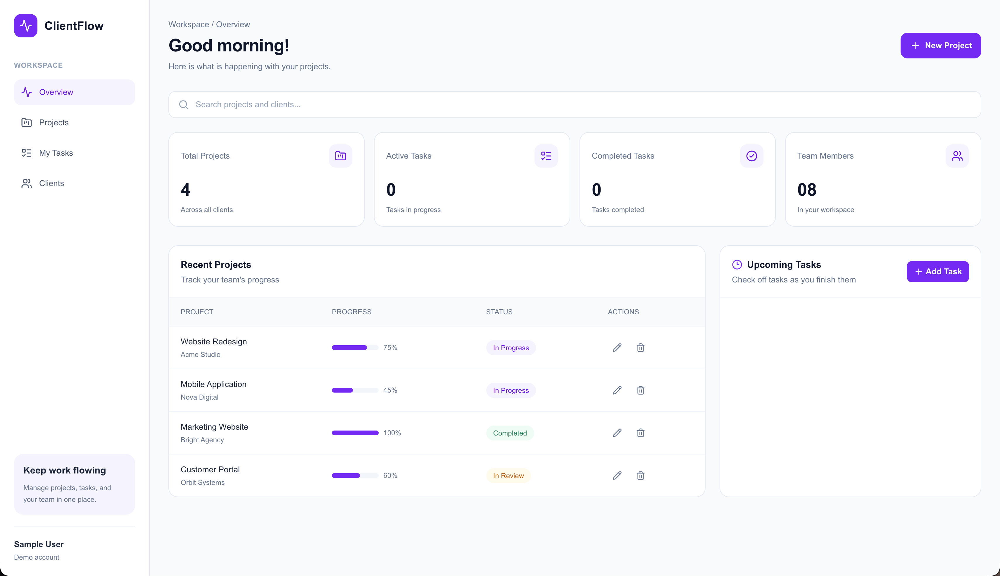
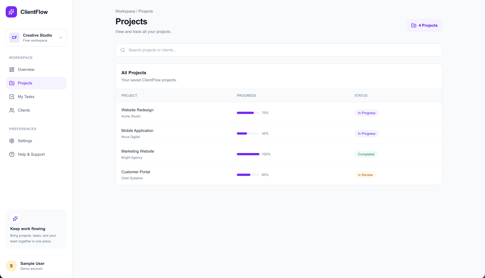
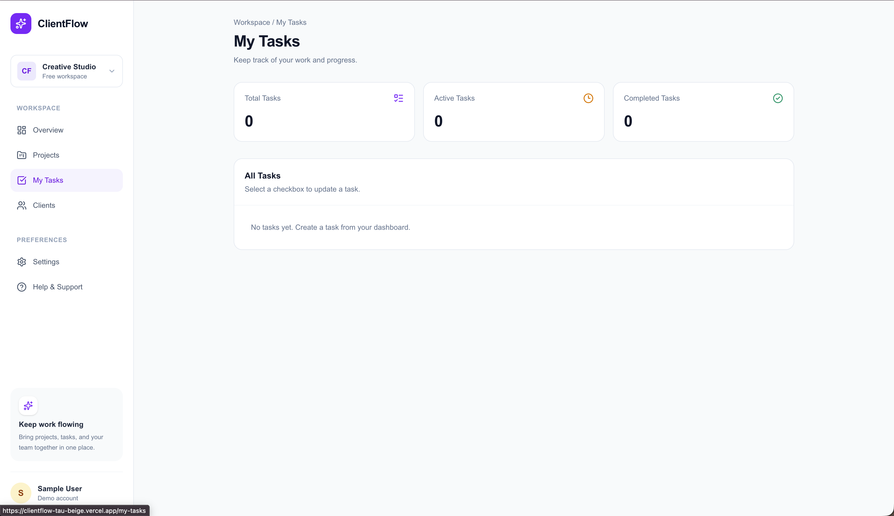
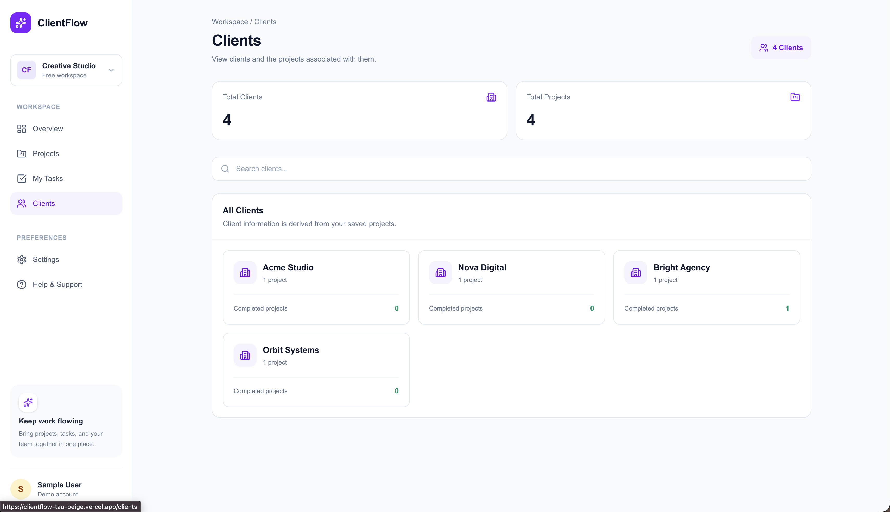

# ClientFlow — Project Management Dashboard

A modern project management dashboard built with **Next.js, React, TypeScript, and Tailwind CSS**. ClientFlow helps organize projects, track tasks, monitor progress, and view client information through a clean, responsive interface.

## 🚀 Live Demo

**[View ClientFlow Live](https://clientflow-tau-beige.vercel.app/)**

## 📸 Screenshots

### Dashboard Overview



### Projects



### My Tasks



### Clients



## ✨ Features

- **Dashboard Overview** — View project statistics, project progress, and task summaries.
- **Project Management** — Create, edit, delete, search, and track projects.
- **Task Management** — Add, edit, delete, and complete tasks, including due dates.
- **Projects Page** — Browse and search saved projects.
- **My Tasks** — View tasks and update their completion status.
- **Clients Page** — View clients derived from project information.
- **Local Data Persistence** — Save projects and tasks in browser local storage.
- **Responsive Interface** — Navigate the application through a sidebar and dashboard layout.

## 🛠️ Tech Stack

- **Framework:** Next.js (App Router)
- **Frontend:** React
- **Language:** TypeScript
- **Styling:** Tailwind CSS
- **Icons:** Lucide React
- **Storage:** Browser Local Storage
- **Version Control:** Git and GitHub
- **Deployment:** Vercel

## 📦 Getting Started

### Prerequisites

- Node.js (version 22 recommended for this project)
- npm
- Git

### Installation

1. Clone the repository:

   ```bash
   git clone https://github.com/Sameerptb/clientflow.git
   ```

2. Navigate to the project directory:

   ```bash
   cd clientflow
   ```

3. Install dependencies:

   ```bash
   npm install
   ```

4. Start the development server:

   ```bash
   npm run dev
   ```

5. Open [http://localhost:3000](http://localhost:3000) in your browser.

## 🧪 Available Scripts

| Command            | Description                          |
| ------------------ | ------------------------------------ |
| `npm run dev`      | Start the development server         |
| `npm run lint`     | Run ESLint checks                    |
| `npx tsc --noEmit` | Check TypeScript types               |
| `npm run build`    | Build the application for production |

## 📁 Project Structure

```text
clientflow/
├── public/
│   └── screenshots/
│       ├── dashboard.png
│       ├── projects.png
│       ├── tasks.png
│       └── clients.png
├── src/
│   ├── app/
│   │   ├── clients/
│   │   │   └── page.tsx
│   │   ├── my-tasks/
│   │   │   └── page.tsx
│   │   ├── projects/
│   │   │   └── page.tsx
│   │   ├── globals.css
│   │   ├── layout.tsx
│   │   └── page.tsx
│   └── components/
│       ├── dashboard-header.tsx
│       ├── projects-table.tsx
│       ├── sidebar.tsx
│       └── stat-card.tsx
├── package.json
└── README.md
```

## 💾 Data Storage

ClientFlow currently uses browser local storage to persist project and task data.

- Data is stored in the browser rather than a remote database.
- Saved data is specific to the browser and website origin being used.
- Data is not automatically synchronized between different users or devices.

## 🔮 Future Improvements

- Integrate a database for persistent, shared data.
- Add user authentication and protected routes.
- Improve project and task synchronization across pages.
- Add automated tests and more comprehensive error handling.
- Improve accessibility and responsive behavior.

## 👨‍💻 Author

**Sameer Husain Pattambi**

- **GitHub:** [Sameerptb](https://github.com/Sameerptb)
- **LinkedIn:** [sameerhusainpattambi](https://www.linkedin.com/in/sameerhusainpattambi)
- **Portfolio:** [sameerptb.vercel.app](https://sameerptb.vercel.app)

---

Built with Next.js and TypeScript.
